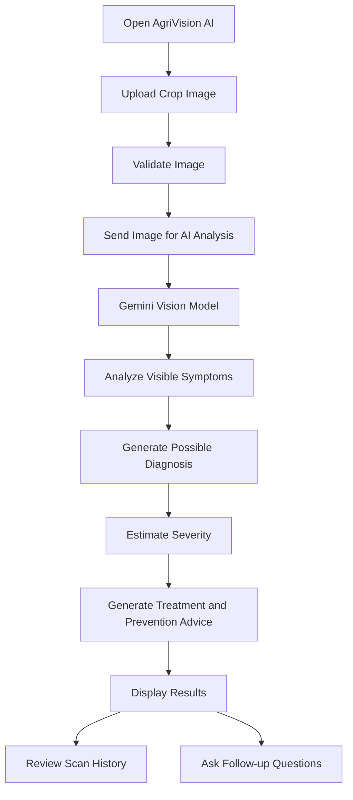
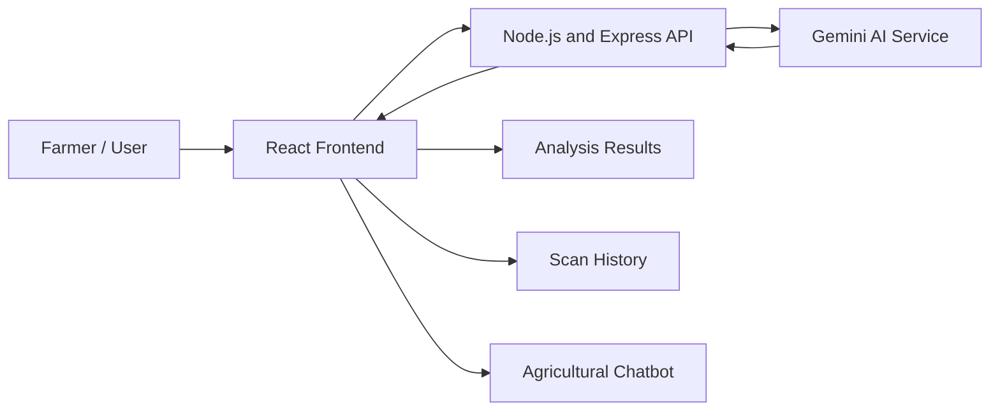

# 🌱 AgriVision AI — Intelligent Crop Health Assistant

**AI-powered crop disease detection, plant health analysis, and smart agricultural guidance.**

AgriVision AI is an AI-powered agricultural assistant designed to help farmers identify potential crop diseases and plant health issues using images. By combining computer vision with generative AI, the platform analyzes uploaded crop images, estimates the severity of visible symptoms, and provides practical treatment and prevention suggestions.

The goal is to make agricultural knowledge more accessible, support early identification of crop health problems, and help farmers make more informed decisions.

🔗 **Live Demo:** [Add your deployed project URL]  
💻 **GitHub Repository:** [Add your GitHub repository URL]

---

## 📌 Table of Contents

- [Overview](#-overview)
- [Problem Statement](#-problem-statement)
- [Our Solution](#-our-solution)
- [Key Features](#-key-features)
- [How It Works](#-how-it-works)
- [Technology Stack](#-technology-stack)
- [System Architecture](#-system-architecture)
- [Getting Started](#-getting-started)
- [Environment Variables](#-environment-variables)
- [Project Structure](#-project-structure)
- [AI Analysis Workflow](#-ai-analysis-workflow)
- [Use Cases](#-use-cases)
- [Responsible AI and Limitations](#-responsible-ai-and-limitations)
- [Future Enhancements](#-future-enhancements)
- [Contributing](#-contributing)
- [License](#-license)
- [Author](#-author)

---

## 🌾 Overview

Agriculture plays a vital role in food security and economic development. However, crops can be affected by fungal infections, bacterial diseases, pests, nutrient deficiencies, and environmental stress.

Identifying these problems at an early stage can be difficult when expert agricultural guidance is not readily available.

**AgriVision AI aims to bridge this gap through AI-powered visual analysis and accessible agricultural assistance.**

Users can upload an image of a crop or plant, receive an AI-generated analysis of possible health issues, review the estimated severity of visible symptoms, and explore suggested treatment and prevention measures.

The platform also provides an agricultural AI chatbot and scan history to make the experience more useful for farmers.

### 🎯 Project Goals

- Make preliminary crop health analysis accessible through a simple interface.
- Help identify possible diseases and visible plant health issues from images.
- Provide understandable treatment and prevention suggestions.
- Encourage early attention to crop health problems.
- Create a foundation for intelligent and accessible digital agriculture.

---

## 🚨 Problem Statement

Farmers may face difficulties identifying crop diseases and plant health issues because of limited access to agricultural experts, time-consuming manual inspection, and a lack of easily accessible diagnostic resources.

Delayed identification can allow crop problems to spread, potentially affecting productivity, quality, and income.

Traditional diagnosis may also require experience in recognizing symptoms that can look similar across different diseases and environmental conditions.

There is a need for an accessible, technology-driven solution that can analyze crop images, explain possible problems, and provide useful initial guidance.

---

## 💡 Our Solution

AgriVision AI provides an AI-powered platform that connects image-based crop analysis with practical agricultural guidance.

The application follows a simple process:

1. **Upload:** The user uploads a clear image of an affected crop or plant.
2. **Analyze:** A vision-capable Gemini AI model analyzes the visible symptoms.
3. **Identify:** The system presents possible diseases or plant health issues.
4. **Assess:** The AI provides an estimated severity level when supported by the available visual evidence.
5. **Recommend:** The user receives suggested treatment, prevention, and care measures.
6. **Track:** Previous scans can be reviewed through the scan history feature.
7. **Ask:** Users can interact with the agricultural AI chatbot for additional guidance.

AgriVision AI is intended to support farmers with preliminary information, not replace laboratory testing or professional agricultural diagnosis.

---

## ✨ Key Features

### 1. 🔍 AI-Powered Crop Disease Detection

- Upload images of leaves, plants, and affected crops.
- Analyze visible symptoms using a vision-capable Gemini AI model.
- Generate possible disease or plant health issue identifications.
- Present findings in an understandable format.

### 2. 🌿 Crop Health and Severity Assessment

- Review the visible condition of the uploaded plant.
- Receive an estimated severity classification when possible.
- Understand the symptoms that may indicate a health problem.
- Get guidance on whether further inspection may be necessary.

### 3. 💊 Treatment and Prevention Recommendations

- Receive AI-generated suggestions for managing possible crop health issues.
- Explore preventive practices to reduce the risk of recurring problems.
- Learn about general crop care and monitoring.
- Obtain practical next steps based on the analysis.

Recommendations should be verified against local agricultural guidance before applying pesticides or other crop treatments.

### 4. 🤖 Agricultural AI Chatbot

- Ask agriculture-related questions in a conversational format.
- Get explanations of common crop health problems.
- Explore general plant care and disease prevention guidance.
- Ask follow-up questions about AI-generated findings.

### 5. 📋 Previous Scan History

- Review previous crop analyses.
- Track observations across different scans.
- Revisit earlier recommendations.
- Support more organized crop health monitoring.

*History persistence depends on the application's configured storage and backend implementation.*

### 6. 📱 Responsive User Interface

- Farmer-friendly and intuitive interface.
- Responsive layouts for desktop, tablet, and mobile devices.
- Clear presentation of analysis results and recommendations.
- Simple navigation designed to reduce complexity for users.

### 7. ⚡ AI-Assisted Agricultural Decision Support

AgriVision AI brings together image analysis, severity estimation, treatment suggestions, and conversational assistance in a single platform.

Its purpose is to make preliminary crop health information easier to access and understand.

---

## 🔄 How It Works



### User Journey

**Step 1 — Upload a crop image**

The user selects a clear image showing the affected plant or crop.

**Step 2 — Analyze the image**

The application sends the image to the configured AI analysis service.

**Step 3 — Review the findings**

The AI returns possible health issues and explanations based on visible symptoms.

**Step 4 — Explore recommendations**

The user reviews suggested treatment, prevention, and crop care measures.

**Step 5 — Track and learn**

The user can revisit previous scans and ask additional questions through the agricultural chatbot.

---

## 🛠️ Technology Stack

AgriVision AI uses modern web technologies to combine a responsive frontend, backend services, and AI-powered image analysis.

| Technology | Purpose |
|---|---|
| React | Building the interactive user interface |
| TypeScript | Type safety and maintainable frontend code |
| Tailwind CSS | Responsive styling and UI design |
| Node.js | Backend JavaScript runtime |
| Express.js | Backend routing and API development |
| Gemini AI | Vision-based crop image analysis and agricultural assistance |
| REST APIs | Communication between frontend and backend |

Additional libraries, databases, image-processing tools, and deployment services may be included depending on the repository's actual implementation.

---

## 🏗️ System Architecture

AgriVision AI follows a frontend–backend–AI service architecture.



### Architecture Components

**Frontend**

The React and TypeScript interface allows users to upload images, view analysis results, and interact with the agricultural assistant.

**Backend**

The Node.js and Express.js server handles API requests and coordinates communication between the frontend and AI service.

**AI Service**

The configured Gemini model processes crop images and generates possible diagnoses, symptom explanations, and agricultural guidance.

**Results and History**

The application presents analysis results and supports access to previous scans according to the implemented history-management mechanism.

---

## 🚀 Getting Started

Follow these steps to run the project locally.

### Prerequisites

Install the following tools before starting:

- [Node.js](https://nodejs.org/) — use a version compatible with the project dependencies.
- npm, which is included with Node.js, or another package manager supported by the repository.
- Git.
- A Gemini API key if your configuration uses Gemini directly.

### 1. Clone the Repository

```bash
git clone YOUR_REPOSITORY_URL
cd YOUR_PROJECT_DIRECTORY
```

Replace the placeholders with your actual GitHub repository URL and project directory.

### 2. Install Dependencies

If the repository uses separate frontend and backend directories, install their dependencies independently.

**Frontend**

```bash
cd client
npm install
```

**Backend**

Open another terminal:

```bash
cd server
npm install
```

Replace `client` and `server` with the actual directory names used in your repository.

If the project has a root-level workspace or a single `package.json`, follow the installation commands defined there instead.

### 3. Configure Environment Variables

Create the appropriate `.env` file for the backend and add the required API credentials.

Example:

```env
GEMINI_API_KEY=your_gemini_api_key
PORT=5000
```

Use the variable names expected by your actual code. Do not expose private API keys in frontend code or commit them to GitHub.

### 4. Start the Backend

From the backend directory, run the command defined in its `package.json`. For example, if the project provides a development script:

```bash
npm run dev
```

### 5. Start the Frontend

From the frontend directory, run its configured development command:

```bash
npm run dev
```

### 6. Open the Application

Open the local URL printed by the frontend development server in your browser.

The exact URL and port depend on your Vite or other frontend configuration.

---

## 🔐 Environment Variables

Keep credentials in environment variables rather than hardcoding them.

| Variable | Description |
|---|---|
| `GEMINI_API_KEY` | API key for the configured Gemini service |
| `PORT` | Port used by the backend server |

These are example variables. Your actual environment configuration may require additional settings, such as a frontend API base URL or database connection string.

### Security Best Practices

- Never commit `.env` files containing secrets.
- Add sensitive environment files to `.gitignore`.
- Use server-side API calls for private AI credentials.
- Validate uploaded image types and sizes.
- Apply appropriate request limits and error handling.
- Configure CORS for trusted frontend origins.
- Use environment variables in deployment settings.

---

## 📁 Project Structure

The following is an illustrative structure for a React, TypeScript, and Express application. Adjust it to match your actual repository.

```text
AgriVision-AI/
│
├── client/
│   ├── public/
│   ├── src/
│   │   ├── components/
│   │   ├── pages/
│   │   ├── services/
│   │   ├── hooks/
│   │   ├── types/
│   │   ├── App.tsx
│   │   └── main.tsx
│   ├── package.json
│   └── ...
│
├── server/
│   ├── routes/
│   ├── controllers/
│   ├── services/
│   ├── middleware/
│   ├── package.json
│   └── ...
│
├── .gitignore
└── README.md
```

*This layout illustrates a possible organization; it does not claim that every listed directory or file already exists in the project.*

---

## 🧠 AI Analysis Workflow

AgriVision AI uses a vision-capable Gemini AI model to analyze uploaded crop images.

A typical analysis can include the following information, depending on the model response and application implementation:

| Analysis Component | Description |
|---|---|
| Crop identification | Possible crop or plant type |
| Health assessment | General observations about visible plant condition |
| Potential issue | Possible disease, pest damage, or other health problem |
| Symptom explanation | Description of visual signs that may support the finding |
| Severity estimate | Preliminary assessment of apparent symptom severity |
| Recommendations | Suggested treatment, prevention, and monitoring steps |

The model should be instructed to distinguish between visible evidence and uncertain conclusions. If an image is unclear or symptoms are ambiguous, the application should communicate that uncertainty rather than present an unsupported diagnosis.

---

## 🎯 Use Cases

### 👨‍🌾 Individual Farmers

Farmers can upload crop images to investigate visible symptoms and learn about possible causes and preventive practices.

### 🌱 Small and Medium Agricultural Operations

Agricultural workers can use image-based analysis as an initial screening tool before seeking additional advice.

### 🧑‍🌾 Agricultural Students and Learners

Students can explore how artificial intelligence and computer vision can be applied to real-world agricultural challenges.

### 🏢 Agricultural Organizations

Farmer groups, cooperatives, and agricultural support organizations could explore the platform as a starting point for digital crop monitoring workflows.

These use cases describe the intended applications and potential future users, not verified deployments or measured outcomes.

---

## 🌍 Impact and Benefits

AgriVision AI aims to support more accessible and technology-assisted agriculture.

- **Accessibility:** Makes preliminary crop health guidance available through a web application.
- **Early awareness:** Encourages users to investigate visible crop symptoms sooner.
- **Education:** Helps users learn about possible plant health problems.
- **Efficiency:** Brings image analysis and agricultural guidance into one workflow.
- **Digital agriculture:** Demonstrates how AI can be applied to practical farming challenges.
- **Scalability:** Provides a foundation for future crop monitoring and agricultural decision-support features.

The actual effect on crop yield, diagnosis accuracy, treatment costs, or farmer income would need to be evaluated through field testing.

---

## ⚠️ Responsible AI and Limitations

AgriVision AI is designed as a preliminary crop health assistant. AI-generated findings may be incomplete or incorrect.

- A photograph may not contain enough information to identify a disease reliably.
- Different diseases, pests, nutrient deficiencies, and environmental stresses can cause similar symptoms.
- Image quality, lighting, crop variety, and growth stage may affect results.
- Severity estimates are preliminary and should not be treated as laboratory-confirmed measurements.
- Treatment recommendations must account for the crop, location, local regulations, and product-specific instructions.
- The system should not guarantee that a crop is healthy simply because no disease is detected.

**Important:** For serious or spreading crop problems, consult a qualified agricultural expert, local agricultural extension service, or a relevant agricultural university. Verify pesticide and treatment recommendations before use.

---

## 🔮 Future Enhancements

AgriVision AI can be extended with additional capabilities to make agricultural support more useful.

- [ ] Support for more crop varieties and regional diseases.
- [ ] Multilingual assistance for farmers.
- [ ] Voice-based agricultural chatbot.
- [ ] Weather-aware crop health insights.
- [ ] Crop-specific recommendations based on region and growth stage.
- [ ] Geolocation-based agricultural advisories.
- [ ] Disease trend visualization and crop health dashboards.
- [ ] Downloadable scan reports.
- [ ] Notifications for follow-up inspections.
- [ ] Integration with verified agricultural knowledge sources.
- [ ] Offline or low-connectivity support.
- [ ] Field testing and evaluation against expert-verified crop diagnoses.

These are proposed improvements and should not be interpreted as existing features.

---

## 🤝 Contributing

Contributions, ideas, bug reports, and suggestions are welcome.

To contribute:

1. Fork the repository.
2. Create a feature branch.
3. Make your changes.
4. Test your changes locally.
5. Commit your work with a descriptive message.
6. Open a pull request explaining your contribution.

Example:

```bash
git checkout -b feature/your-feature
git add .
git commit -m "Add your feature"
git push origin feature/your-feature
```

Please keep contributions focused, document significant changes, and avoid committing API keys or other sensitive information.

---

## 📄 License

A license has not been specified in this README. Before distributing or reusing the project, choose an appropriate open-source license and add its corresponding `LICENSE` file to the repository.

---

## 👨‍💻 Author

**Ritesh Kumar**

B.Tech Computer Science and Engineering student interested in software development, artificial intelligence, and practical technology solutions.

AgriVision AI reflects an effort to explore how AI-powered image analysis and modern web technologies can help address real-world agricultural challenges.

- **LinkedIn:** [Ritesh Kumar](https://www.linkedin.com/in/ritesh-kumar-b88032383/)
- **GitHub:** [Ritesh302006](https://github.com/Ritesh302006)

---

## ⭐ Support the Project

If you find AgriVision AI interesting, consider starring the repository on GitHub, sharing your feedback, or contributing ideas to improve the project.

Every suggestion and contribution can help make AI-assisted agricultural tools more useful and accessible.

**Built with 🌱 for smarter and more accessible agriculture.**

*AgriVision AI — See the problem. Understand the crop. Explore smarter solutions.*

